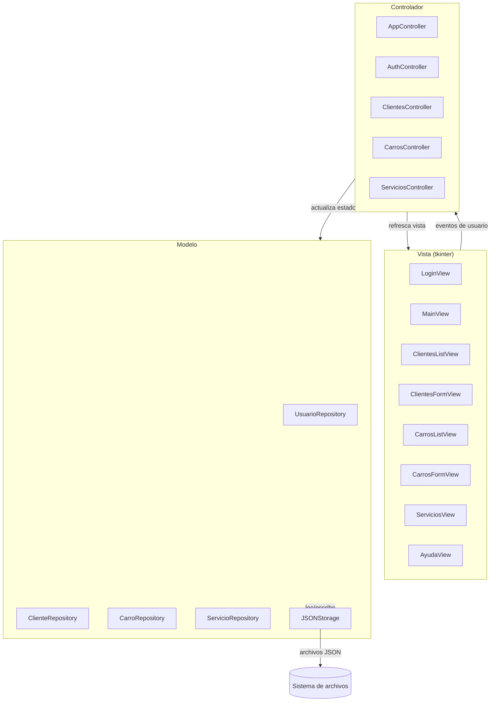
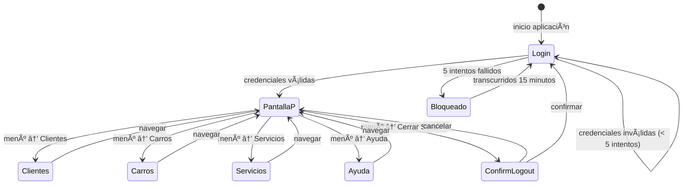
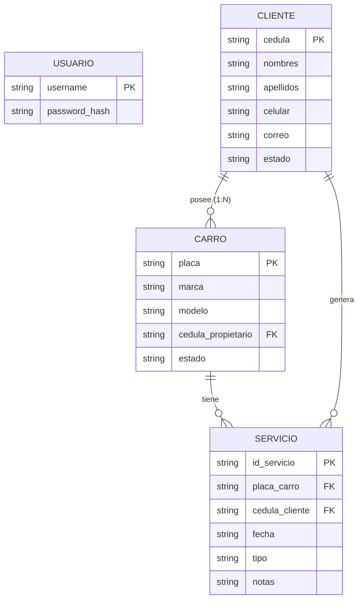

# Documento de Diseño Técnico — Serviteca ADSO

## Resumen ejecutivo

Este documento describe la arquitectura técnica y el diseño detallado de la aplicación de escritorio **Serviteca ADSO**: un sistema de gestión para talleres de vehículos construido en Python con interfaz gráfica tkinter y persistencia en archivos JSON locales. El documento cubre la arquitectura MVC, los componentes principales, los modelos de datos, las propiedades de corrección verificables, el manejo de errores y la estrategia de pruebas.

---

## Overview

### Contexto del sistema

La aplicación Serviteca ADSO es un sistema monousuario de escritorio diseñado para el personal de talleres automotrices. Permite gestionar el ciclo completo de atención al cliente: desde el registro de clientes y vehículos hasta el seguimiento del historial de servicios prestados.

### Objetivos técnicos principales

- **Sin dependencias externas**: toda la interfaz usa `tkinter` (estándar de Python) y la persistencia usa el módulo `json` de la librería estándar.
- **Arquitectura limpia**: separación estricta de responsabilidades mediante el patrón MVC.
- **Robustez ante fallos**: manejo explícito de errores de I/O, validación defensiva de entradas y recuperación graceful.
- **Portabilidad**: compatible con Windows, macOS y Linux con Python 3.10+.

### Alcance

| Módulo | Funcionalidad |
|---|---|
| Autenticación | Login / logout con bloqueo por intentos fallidos |
| Clientes | CRUD completo, búsqueda, suspensión de cuenta |
| Carros | CRUD completo, búsqueda, suspensión de vehículo |
| Servicios | Registro de servicios, historial por placa |
| Ayuda | Pantalla de instrucciones offline |
| Persistencia | Lectura/escritura de archivos JSON locales |

### Decisiones tecnológicas clave

| Decisión | Alternativas consideradas | Justificación |
|---|---|---|
| `tkinter` para GUI | PyQt5, wxPython, customtkinter | Librería estándar, sin instalación, soportada en todas las plataformas Python |
| JSON para persistencia | SQLite, CSV, pickle | Legible por humanos, sin dependencias, fácil de depurar y respaldar |
| Patrón MVC | MVP, MVVM | Claridad conceptual para el nivel ADSO, separación explícita de capas |
| `dataclasses` para modelos | dict puro, Pydantic | Tipado fuerte sin dependencias externas; compatible con Python 3.7+ |
| `hypothesis` para PBT | QuickCheck (Haskell), fast-check (JS) | Librería de property-based testing más madura para Python |

---

## Architecture

### Patrón MVC aplicado a tkinter



### Descripción de capas

**Capa Vista (`views/`)**
- Solo contiene código de presentación tkinter (widgets, layouts, binding de eventos).
- No tiene lógica de negocio ni acceso directo a datos.
- Expone métodos de actualización que el controlador llama: `update_table()`, `show_error()`, `clear_form()`, etc.

**Capa Controlador (`controllers/`)**
- Orquesta las interacciones entre vistas y modelos.
- Contiene toda la lógica de validación de entradas y reglas de negocio.
- `AppController` es el punto de entrada principal: gestiona la ventana raíz y el ciclo de vida de la sesión.

**Capa Modelo (`models/`, `repositories/`)**
- `models/` define las estructuras de datos (`dataclasses`).
- `repositories/` encapsula las operaciones CRUD sobre los archivos JSON.
- `JSONStorage` es el adaptador de bajo nivel para lectura/escritura de archivos.

### Flujo de navegación



### Estructura de directorios del proyecto

```
serviteca_adso/
├── main.py                    # Punto de entrada
├── config.py                  # Constantes globales (rutas JSON, timeouts)
├── models/
│   ├── __init__.py
│   ├── usuario.py             # dataclass Usuario
│   ├── cliente.py             # dataclass Cliente + EstadoCliente enum
│   ├── carro.py               # dataclass Carro + EstadoCarro enum
│   └── servicio.py            # dataclass Servicio + TipoServicio enum
├── repositories/
│   ├── __init__.py
│   ├── json_storage.py        # Adaptador JSON (load/save atómico)
│   ├── usuario_repository.py
│   ├── cliente_repository.py
│   ├── carro_repository.py
│   └── servicio_repository.py
├── controllers/
│   ├── __init__.py
│   ├── app_controller.py      # Orquestador principal
│   ├── auth_controller.py     # Lógica de autenticación y bloqueo
│   ├── clientes_controller.py
│   ├── carros_controller.py
│   └── servicios_controller.py
├── views/
│   ├── __init__.py
│   ├── base_view.py           # Frame base con helpers comunes
│   ├── login_view.py
│   ├── main_view.py           # Frame principal con menú lateral
│   ├── clientes_view.py
│   ├── carros_view.py
│   ├── servicios_view.py
│   └── ayuda_view.py
├── data/                      # Archivos JSON de persistencia (generados en runtime)
│   ├── usuarios.json
│   ├── clientes.json
│   ├── carros.json
│   └── servicios.json
└── tests/
    ├── unit/
    │   ├── test_auth_controller.py
    │   ├── test_clientes_controller.py
    │   ├── test_carros_controller.py
    │   └── test_servicios_controller.py
    └── property/
        ├── test_auth_properties.py
        ├── test_clientes_properties.py
        ├── test_carros_properties.py
        ├── test_servicios_properties.py
        └── test_persistencia_properties.py
```

---

## Components and Interfaces

### AppController

Responsabilidad: gestionar el ciclo de vida de la ventana raíz de tkinter, el estado de sesión global y la navegación entre vistas.

```python
class AppController:
    def __init__(self, root: tk.Tk) -> None: ...
    def start(self) -> None:
        """Inicializa repositorios, lanza LoginView y entra al mainloop."""
    def on_login_success(self, usuario: Usuario) -> None:
        """Recibe el usuario autenticado, guarda la sesión y muestra MainView."""
    def on_logout(self) -> None:
        """Invalida la sesión activa y regresa a LoginView."""
    def navigate_to(self, modulo: str) -> None:
        """Carga el frame del módulo indicado en el área de contenido."""
    def require_auth(self) -> bool:
        """Devuelve True si hay sesión activa; redirige a login si no."""
```

### AuthController

Responsabilidad: validar credenciales, gestionar el contador de intentos fallidos y el bloqueo temporal.

```python
class AuthController:
    MAX_INTENTOS: int = 5
    TIEMPO_BLOQUEO_SEGUNDOS: int = 900  # 15 minutos

    def autenticar(self, usuario: str, contraseña: str) -> ResultadoAuth:
        """
        Valida las credenciales. Retorna ResultadoAuth con:
        - exito: bool
        - usuario: Optional[Usuario]
        - mensaje_error: Optional[str]
        """
    def registrar_intento_fallido(self) -> None: ...
    def esta_bloqueado(self) -> bool: ...
    def segundos_restantes_bloqueo(self) -> int: ...
    def reiniciar_intentos(self) -> None: ...
```

### ClientesController

Responsabilidad: operaciones CRUD de clientes, validaciones de negocio y sincronización con la vista.

```python
class ClientesController:
    def crear_cliente(self, datos: dict) -> ResultadoOperacion: ...
    def editar_cliente(self, cedula_original: str, datos: dict) -> ResultadoOperacion: ...
    def eliminar_cliente(self, cedula: str) -> ResultadoOperacion: ...
    def suspender_cliente(self, cedula: str) -> ResultadoOperacion: ...
    def buscar_clientes(self, texto: str) -> list[Cliente]: ...
    def obtener_todos(self) -> list[Cliente]: ...
    def _validar_datos_cliente(self, datos: dict, cedula_excluir: str = "") -> list[str]:
        """Retorna lista de mensajes de error; vacía si es válido."""
```

### CarrosController

Responsabilidad: operaciones CRUD de carros, validaciones de negocio y sincronización con la vista.

```python
class CarrosController:
    def crear_carro(self, datos: dict) -> ResultadoOperacion: ...
    def editar_carro(self, placa_original: str, datos: dict) -> ResultadoOperacion: ...
    def eliminar_carro(self, placa: str) -> ResultadoOperacion: ...
    def suspender_carro(self, placa: str) -> ResultadoOperacion: ...
    def buscar_carros(self, texto: str) -> list[Carro]: ...
    def obtener_todos(self) -> list[Carro]: ...
    def obtener_carros_por_cliente(self, cedula: str) -> list[Carro]:
        """Retorna todos los Carros cuyo cedula_propietario coincide con la cedula dada."""
    def _validar_datos_carro(self, datos: dict, placa_excluir: str = "") -> list[str]:
        """
        Valida: placa alfanumerica 5-7 chars, marca/modelo no vacios <= 50,
        cedula_propietario existe en ClienteRepository.
        Retorna lista de mensajes de error; vacia si es valido.
        """
```

### ServiciosController

Responsabilidad: registro de servicios y consulta del historial por placa.

```python
class ServiciosController:
    def registrar_servicio(self, datos: dict) -> ResultadoOperacion: ...
    def obtener_historial_por_placa(self, placa: str) -> list[Servicio]:
        """Retorna servicios ordenados por fecha descendente."""
    def _validar_datos_servicio(self, datos: dict) -> list[str]: ...
```

### JSONStorage

Responsabilidad: lectura y escritura atómica de archivos JSON.

```python
class JSONStorage:
    def __init__(self, ruta: str) -> None: ...
    def cargar(self) -> list[dict]:
        """Lee el archivo JSON. Retorna lista vacía si no existe."""
    def guardar(self, datos: list[dict]) -> None:
        """Escribe de forma atómica usando archivo temporal + rename."""
    def existe(self) -> bool: ...
```

> **Decisión de diseño — escritura atómica**: para evitar corrupción de datos ante cierres inesperados, `JSONStorage.guardar()` escribe primero a un archivo temporal (`.tmp`) y luego hace `os.replace()` al archivo definitivo. Esta operación es atómica en sistemas de archivos POSIX y en Windows NTFS (Python 3.3+).

### Interfaces de vista (contratos)

Cada vista implementa los siguientes métodos mínimos para ser controlada desde el controlador:

```python
class BaseView(tk.Frame):
    def mostrar(self) -> None: ...
    def ocultar(self) -> None: ...
    def show_error(self, mensaje: str) -> None: ...
    def show_info(self, mensaje: str) -> None: ...
```

---

## Data Models

### Usuario

```python
from dataclasses import dataclass

@dataclass
class Usuario:
    username: str          # identificador único, case-insensitive en validación
    password_hash: str     # SHA-256 del password; nunca se almacena el plaintext
```

**Archivo JSON**: `data/usuarios.json`
```json
[
  {
    "username": "admin",
    "password_hash": "8c6976e5b5410415bde908bd4dee15dfb167a9c873fc4bb8a81f6f2ab448a918"
  }
]
```

> **Decisión de seguridad**: las contraseñas se almacenan como hash SHA-256 (módulo `hashlib` estándar de Python). En una aplicación de producción se recomendaría bcrypt o PBKDF2, pero dado el contexto de escritorio sin servidor, SHA-256 es suficiente y no requiere dependencias externas.

---

### Cliente

```python
from dataclasses import dataclass, field
from enum import Enum

class EstadoCliente(str, Enum):
    ACTIVO = "Activo"
    SUSPENDIDO = "Suspendido"

@dataclass
class Cliente:
    cedula: str              # 1–10 dígitos numéricos; clave primaria
    nombres: str             # máx 100 caracteres
    apellidos: str           # máx 100 caracteres
    celular: str             # máx 15 dígitos numéricos
    correo: str = ""         # formato email válido o cadena vacía; opcional
    estado: EstadoCliente = EstadoCliente.ACTIVO
```

**Archivo JSON**: `data/clientes.json`
```json
[
  {
    "cedula": "1234567890",
    "nombres": "Juan",
    "apellidos": "Pérez",
    "celular": "3001234567",
    "correo": "juan@ejemplo.com",
    "estado": "Activo"
  }
]
```

**Reglas de validación**:
- `cedula`: solo dígitos, longitud 1–10. Único en el repositorio.
- `nombres`, `apellidos`: no vacíos, longitud ≤ 100.
- `celular`: solo dígitos, longitud 1–15.
- `correo`: si no está vacío, debe coincidir con el patrón `^[^@\s]+@[^@\s]+\.[^@\s]+$`.

---

### Carro

```python
class EstadoCarro(str, Enum):
    ACTIVO = "Activo"
    INACTIVO = "Inactivo"

@dataclass
class Carro:
    placa: str              # 5–7 caracteres alfanuméricos; clave primaria
    marca: str              # máx 50 caracteres
    modelo: str             # máx 50 caracteres
    estado: EstadoCarro = EstadoCarro.ACTIVO
```

**Archivo JSON**: `data/carros.json`
```json
[
  {
    "placa": "ABC123",
    "marca": "Toyota",
    "modelo": "Corolla",
    "cedula_propietario": "1234567890",
    "estado": "Activo"
  }
]
```

**Reglas de validación**:
- `placa`: solo caracteres alfanuméricos (`[A-Za-z0-9]`), longitud 5–7. Único en el repositorio.
- `marca`, `modelo`: no vacíos, longitud <= 50.
- `cedula_propietario`: obligatorio; debe existir en el repositorio de Clientes (integridad referencial). Un Cliente puede tener múltiples Carros; cada Carro tiene exactamente un propietario (relación **uno a muchos** `Cliente -> Carro`).

---

### Servicio

```python
from datetime import date

class TipoServicio(str, Enum):
    MANTENIMIENTO = "Mantenimiento"
    CAMBIO_ACEITE = "Cambio de Aceite"
    FRENOS = "Frenos"
    REVISION_GENERAL = "Revisión General"
    OTRO = "Otro"

@dataclass
class Servicio:
    id_servicio: str        # UUID generado en creación
    placa_carro: str        # FK a Carro.placa
    cedula_cliente: str     # FK a Cliente.cedula
    fecha: date             # ≤ fecha actual; almacenada como "YYYY-MM-DD"
    tipo: TipoServicio
    notas: str = ""         # máx 500 caracteres; opcional
```

**Archivo JSON**: `data/servicios.json`
```json
[
  {
    "id_servicio": "a1b2c3d4-...",
    "placa_carro": "ABC123",
    "cedula_cliente": "1234567890",
    "fecha": "2024-11-15",
    "tipo": "Mantenimiento",
    "notas": "Cambio filtros y revisión completa"
  }
]
```

**Reglas de validación**:
- `placa_carro`: debe existir en el repositorio de Carros.
- `cedula_cliente`: debe existir en el repositorio de Clientes.
- `fecha`: formato ISO 8601, no puede ser posterior a `date.today()`.
- `tipo`: debe ser uno de los valores definidos en `TipoServicio`.
- `notas`: longitud ≤ 500 si se provee.

---

### ResultadoOperacion (DTO compartido)

```python
@dataclass
class ResultadoOperacion:
    exito: bool
    mensaje: str = ""
    errores: list[str] = field(default_factory=list)
    dato: object = None  # entidad resultante cuando exito=True
```

---

### Diagrama de relaciones entre entidades



> **Decisión de diseño — relación uno a muchos Cliente → Carro**: cada `Carro` almacena la `cedula_propietario` como clave foránea hacia `Cliente.cedula`. Esta FK se valida en `CarrosController._validar_datos_carro()` antes de persistir. No se implementa eliminación en cascada: si se elimina un Cliente, sus Carros quedan huérfanos y deben eliminarse o reasignarse manualmente. Esta decisión es deliberada para el contexto de escritorio monousuario: conservar el historial de servicios asociado a la placa tiene más valor operativo que forzar la cascada. En una versión futura se puede añadir una validación de integridad en `ClienteRepository.eliminar()`.

---

## Correctness Properties

*Una propiedad es una característica o comportamiento que debe ser verdadero en todas las ejecuciones válidas de un sistema — esencialmente, una afirmación formal sobre lo que el sistema debe hacer. Las propiedades sirven como puente entre especificaciones legibles por humanos y garantías de corrección verificables por máquinas.*

---

### Property 1: Autenticación correcta para cualquier credencial

*Para cualquier* par (usuario, contraseña), la función de autenticación debe retornar éxito si y solo si el par coincide con un registro válido del repositorio. Para pares inválidos, debe retornar un error genérico que no revele cuál campo es incorrecto.

**Validates: Requirements 1.4, 1.5**

---

### Property 2: Rechazo de credenciales con campos vacíos

*Para cualquier* combinación donde el campo usuario o el campo contraseña (o ambos) sean cadenas vacías, la validación previa a la autenticación debe rechazar el intento sin consultar el repositorio.

**Validates: Requirements 1.6**

---

### Property 3: Bloqueo por intentos fallidos consecutivos

*Para cualquier* secuencia de N intentos de autenticación fallidos donde N ≥ 5, el sistema debe reportar estado bloqueado al finalizar la secuencia, independientemente del orden o contenido de las credenciales inválidas.

**Validates: Requirements 1.7**

---

### Property 4: Validación de campos obligatorios de Cliente

*Para cualquier* conjunto de datos de cliente donde uno o más campos obligatorios (cédula, nombres, apellidos, celular) estén vacíos o tengan formato inválido, la función de validación debe retornar al menos un mensaje de error y no persistir el registro.

**Validates: Requirements 3.2, 3.8, 3.13**

---

### Property 5: Unicidad de cédula en el sistema

*Para cualquier* cédula ya registrada en el repositorio de clientes, cualquier intento de crear o editar un cliente con esa misma cédula (perteneciente a un registro distinto) debe ser rechazado con un mensaje de conflicto.

**Validates: Requirements 3.3, 3.9**

---

### Property 6: Estado inicial "Activo" al crear cliente

*Para cualquier* cliente creado exitosamente a través del formulario de registro, su Estado_Cliente inicial debe ser "Activo", independientemente de los datos ingresados.

**Validates: Requirements 3.4**

---

### Property 7: Filtrado de clientes es case-insensitive y completo

*Para cualquier* lista de clientes y cualquier texto de búsqueda no vacío, todos los registros retornados por la función de filtrado deben contener el texto de búsqueda (ignorando mayúsculas y minúsculas) en al menos uno de los campos: nombres, apellidos o cédula; y ningún registro que contenga el texto debe ser excluido.

**Validates: Requirements 3.6**

---

### Property 8: Round-trip de carga de cliente para edición

*Para cualquier* cliente registrado en el repositorio, cargar sus datos en el formulario de edición debe producir exactamente el mismo conjunto de campos que el registro almacenado — sin pérdida, alteración ni adición de valores.

**Validates: Requirements 3.7**

---

### Property 9: Suspensión de cliente activo

*Para cualquier* cliente con Estado_Cliente "Activo", aplicar la acción "Suspender" debe producir Estado_Cliente "Suspendido" y persistir ese cambio inmediatamente en el repositorio.

**Validates: Requirements 3.11**

---

### Property 10: Validación de formato de placa de Carro

*Para cualquier* cadena de texto que no cumpla exactamente con el patrón alfanumérico de 5 a 7 caracteres, la validación de placa debe rechazarla. Para cualquier cadena que sí cumpla el patrón, la validación debe aceptarla.

**Validates: Requirements 4.2, 4.3**

---

### Property 11: Unicidad de placa en el sistema

*Para cualquier* placa ya registrada en el repositorio de carros, cualquier intento de crear o editar un carro con esa misma placa (perteneciente a un registro distinto) debe ser rechazado con un mensaje de conflicto.

**Validates: Requirements 4.4, 4.9**

---

### Property 12: Filtrado de carros es case-insensitive y completo

*Para cualquier* lista de carros y cualquier texto de búsqueda no vacío, todos los registros retornados deben contener el texto (ignorando mayúsculas y minúsculas) en al menos uno de los campos: placa, marca o modelo; y ningún registro que contenga el texto debe ser excluido.

**Validates: Requirements 4.6**

---

### Property 13: Suspensión de carro activo

*Para cualquier* carro con Estado_Carro "Activo", aplicar la acción "Suspender" debe producir Estado_Carro "Inactivo" y persistir ese cambio en el repositorio.

**Validates: Requirements 4.12**

---

### Property 14: Rechazo de fechas futuras en Servicios

*Para cualquier* fecha posterior a la fecha actual del sistema, el selector de fecha y la validación del formulario de servicios deben rechazar esa fecha como inválida.

**Validates: Requirements 5.2**

---

### Property 15: Integridad referencial al registrar un Servicio

*Para cualquier* intento de registrar un servicio, si la placa del carro o la cédula del cliente no existen en sus respectivos repositorios, el registro debe ser rechazado con el mensaje de error correspondiente; si ambas referencias existen y el resto de campos son válidos, el servicio debe guardarse exitosamente.

**Validates: Requirements 5.4, 5.5, 5.6, 5.7**

---

### Property 16: Completitud del historial de servicios por placa

*Para cualquier* placa registrada a la que se le hayan asociado N servicios, la consulta del historial debe retornar exactamente esos N servicios, sin omisiones ni duplicados.

**Validates: Requirements 6.2**

---

### Property 17: Orden descendente del historial de servicios

*Para cualquier* lista de servicios retornada por la consulta histórica de una placa, cada servicio en la posición i debe tener una fecha mayor o igual a la del servicio en la posición i+1 (orden descendente por fecha).

**Validates: Requirements 6.6**

---

### Property 18: Sesión cerrada impide acceso a módulos protegidos

*Para cualquier* módulo protegido del sistema (Clientes, Carros, Servicios, Ayuda), intentar acceder con la sesión invalidada debe resultar en redirección a la pantalla de login, sin mostrar datos del módulo solicitado.

**Validates: Requirements 8.4, 8.5**

---

### Property 19: Round-trip de serialización JSON

*Para cualquier* entidad del sistema (Cliente, Carro, Servicio), serializar la entidad a JSON y luego deserializar el resultado debe producir una entidad equivalente campo a campo, sin pérdida de datos ni alteración de valores.

**Validates: Requirements 9.1**

---

## Error Handling

### Principios generales

1. **Fallo observable**: todo error que afecte al usuario debe mostrarse mediante un diálogo o etiqueta de error visible, nunca silenciarse.
2. **Fallo aislado**: un error en un módulo no debe propagar excepciones no manejadas que cierren la aplicación.
3. **Preservación de datos**: ante errores de escritura, los datos existentes no se modifican (gracias a la escritura atómica).
4. **Recuperabilidad**: ante errores de carga de datos al inicio, el sistema arranca con tablas vacías y permite operación normal.

### Clasificación de errores

| Categoría | Ejemplo | Tratamiento |
|---|---|---|
| Validación de entrada | Cédula con letras, placa muy corta | Mensaje inline debajo del campo afectado |
| Conflicto de negocio | Cédula duplicada, placa ya registrada | `messagebox.showerror()` con descripción del conflicto |
| Error de I/O al guardar | Disco lleno, permisos denegados | `messagebox.showerror()` indicando que no se pudo guardar; operación cancelada |
| Error de I/O al cargar | JSON malformado, archivo corrupto | `messagebox.showwarning()` al inicio; tablas se muestran vacías |
| Repositorio de usuarios no disponible | `usuarios.json` ausente o corrupto | Denegar acceso; mostrar `messagebox.showerror()` |
| Referencia inválida en Servicio | Placa o cédula no registrada | Mensaje de error específico antes de intentar guardar |

### Estrategia de manejo en repositorios

```python
# Patrón en JSONStorage.guardar()
def guardar(self, datos: list[dict]) -> None:
    ruta_tmp = self.ruta + ".tmp"
    try:
        with open(ruta_tmp, "w", encoding="utf-8") as f:
            json.dump(datos, f, ensure_ascii=False, indent=2)
        os.replace(ruta_tmp, self.ruta)
    except OSError as e:
        # Limpiar archivo temporal si existe
        if os.path.exists(ruta_tmp):
            os.remove(ruta_tmp)
        raise StorageError(f"No se pudo guardar en {self.ruta}: {e}") from e
```

```python
# Patrón en JSONStorage.cargar()
def cargar(self) -> list[dict]:
    if not os.path.exists(self.ruta):
        return []
    try:
        with open(self.ruta, "r", encoding="utf-8") as f:
            return json.load(f)
    except (json.JSONDecodeError, OSError) as e:
        raise StorageError(f"No se pudo leer {self.ruta}: {e}") from e
```

### Manejo de bloqueo de autenticación

El `AuthController` mantiene en memoria el contador de intentos y el timestamp del primer intento fallido de la serie actual. Al iniciar la aplicación, el bloqueo no persiste entre reinicios (decisión de diseño: para uso monousuario de escritorio, reiniciar la app equivale a reiniciar el período de bloqueo — aceptable dado el contexto).

### Propagación de errores hacia la vista

Los controladores nunca lanzan excepciones hacia las vistas. En su lugar retornan `ResultadoOperacion(exito=False, mensaje=..., errores=[...])`. Las vistas inspeccionan este objeto y muestran el feedback correspondiente.

---

## Testing Strategy

### Enfoque dual: pruebas de ejemplo + pruebas de propiedades

La estrategia combina dos tipos complementarios de prueba:

- **Pruebas de ejemplo (unittest)**: verifican comportamientos concretos, casos límite y flujos de integración.
- **Pruebas de propiedades (hypothesis)**: verifican propiedades universales sobre el espacio de entradas completo con generación aleatoria de datos.

### Biblioteca de property-based testing

Se utiliza **[Hypothesis](https://hypothesis.readthedocs.io/)** (Python), la librería de PBT más madura del ecosistema Python.

Instalación:
```
pip install hypothesis
```

Cada prueba de propiedad se configura con un mínimo de 100 iteraciones:
```python
from hypothesis import given, settings
from hypothesis import strategies as st

@settings(max_examples=100)
@given(...)
def test_propiedad_N(...):
    ...
```

Cada prueba referencia su propiedad de diseño con un comentario:
```python
# Feature: serviteca-gestion, Property 5: Unicidad de cédula en el sistema
```

### Cobertura por módulo

#### Módulo de Autenticación (`test_auth_properties.py`, `test_auth_controller.py`)

| Tipo | Qué verifica |
|---|---|
| Propiedad | Prop 1 — autenticación correcta para cualquier credencial |
| Propiedad | Prop 2 — rechazo de campos vacíos |
| Propiedad | Prop 3 — bloqueo tras N ≥ 5 intentos fallidos |
| Ejemplo | Hash SHA-256 correcto al crear usuario |
| Ejemplo | Repositorio no disponible → acceso denegado |
| Ejemplo | Tiempo de validación ≤ 3 segundos |

#### Módulo de Clientes (`test_clientes_properties.py`, `test_clientes_controller.py`)

| Tipo | Qué verifica |
|---|---|
| Propiedad | Prop 4 — validación de campos obligatorios |
| Propiedad | Prop 5 — unicidad de cédula |
| Propiedad | Prop 6 — estado inicial "Activo" |
| Propiedad | Prop 7 — filtrado case-insensitive |
| Propiedad | Prop 8 — round-trip de carga para edición |
| Propiedad | Prop 9 — suspensión de cliente activo |
| Ejemplo | Eliminación con confirmación |
| Ejemplo | Indicador visual diferenciado Activo/Suspendido |

#### Módulo de Carros (`test_carros_properties.py`, `test_carros_controller.py`)

| Tipo | Qué verifica |
|---|---|
| Propiedad | Prop 10 — validación de formato de placa |
| Propiedad | Prop 11 — unicidad de placa |
| Propiedad | Prop 12 — filtrado case-insensitive |
| Propiedad | Prop 13 — suspensión de carro activo |
| Ejemplo | Round-trip de carga para edición (análogo a Prop 8) |
| Ejemplo | Estado inicial "Activo" al crear carro |

#### Módulo de Servicios (`test_servicios_properties.py`, `test_servicios_controller.py`)

| Tipo | Qué verifica |
|---|---|
| Propiedad | Prop 14 — rechazo de fechas futuras |
| Propiedad | Prop 15 — integridad referencial |
| Propiedad | Prop 16 — completitud del historial |
| Propiedad | Prop 17 — orden descendente del historial |
| Ejemplo | Formulario con las 5 opciones exactas de Tipo_Servicio |
| Ejemplo | Reset del formulario tras guardado exitoso |

#### Persistencia (`test_persistencia_properties.py`)

| Tipo | Qué verifica |
|---|---|
| Propiedad | Prop 19 — round-trip de serialización JSON |
| Ejemplo | Escritura atómica: no corrupción ante interrupción simulada |
| Ejemplo | Carga de datos al inicio con archivo ausente → lista vacía |
| Ejemplo | Carga con JSON malformado → StorageError controlado |

### Configuración de ejecución

Ejecutar todas las pruebas:
```bash
python -m pytest tests/ -v
```

Ejecutar solo pruebas de propiedades:
```bash
python -m pytest tests/property/ -v
```

Ejecutar solo pruebas de ejemplo:
```bash
python -m pytest tests/unit/ -v
```

### Generadores Hypothesis para este proyecto

```python
from hypothesis import strategies as st
import string

# Generador de cédulas válidas (1-10 dígitos)
cedula_valida = st.text(alphabet=string.digits, min_size=1, max_size=10).filter(lambda s: s.lstrip("0") != "" or s == "0")

# Generador de placas válidas (5-7 alfanuméricos)
placa_valida = st.text(alphabet=string.ascii_letters + string.digits, min_size=5, max_size=7)

# Generador de placas inválidas (fuera del rango o con caracteres especiales)
placa_invalida = st.one_of(
    st.text(alphabet=string.ascii_letters + string.digits, max_size=4),   # muy corta
    st.text(alphabet=string.ascii_letters + string.digits, min_size=8),   # muy larga
    st.text(alphabet=string.printable, min_size=5, max_size=7).filter(   # con especiales
        lambda s: any(c not in string.ascii_letters + string.digits for c in s)
    )
)

# Generador de fechas pasadas o presentes
from datetime import date, timedelta
fecha_valida = st.dates(max_value=date.today())
fecha_futura = st.dates(min_value=date.today() + timedelta(days=1))
```

### Nota sobre pruebas de UI (tkinter)

Los componentes tkinter no se prueban de forma directa con Hypothesis dado que requieren un entorno de display. La estrategia es:

1. **Lógica de negocio y validación**: 100% testeable de forma unitaria y con propiedades (sin tkinter).
2. **Controladores**: testeables de forma unitaria usando repositorios mock en memoria.
3. **Vistas**: verificables mediante pruebas de ejemplo con `tk.Tk()` instanciado en modo headless (usando variable de entorno `DISPLAY=:0` en Linux o mocking de `messagebox` en tests).

Las propiedades definidas en este documento se implementan sobre la capa de controladores y repositorios, que son completamente independientes de tkinter.

---

## Interfaz de Usuario — Paleta de Color y Modo Claro/Oscuro

### Paleta de colores

La interfaz usa una gama activa y llamativa basada en tres colores base:

| Token CSS | Modo Oscuro | Modo Claro | Uso |
|---|---|---|---|
| `--clr-bg` | `#121820` | `#f4f6fa` | Fondo general de la aplicacion |
| `--clr-surface` | `#1a2230` | `#ffffff` | Superficies secundarias (topbar, sidebar) |
| `--clr-card` | `#1f2d3d` | `#ffffff` | Tarjetas, tablas, modales |
| `--clr-primary` | `#FF6B00` | `#FF6B00` | Accion principal, botones, enlaces, acento naranja |
| `--clr-text` | `#FFFFFF` | `#121820` | Texto principal |
| `--clr-muted` | `#8a9bb0` | `#5a6a7a` | Texto secundario, etiquetas, placeholder |
| `--clr-danger` | `#ff4d4d` | `#e03030` | Errores, eliminacion |
| `--clr-border` | `#2a3d52` | `#d8e0ea` | Bordes de elementos |

> **Decision de diseno**: el naranja `#FF6B00` se usa como unico color de acento en ambos temas para mantener coherencia visual. El fondo oscuro `#121820` provee contraste alto con el texto blanco `#FFFFFF`, cumpliendo WCAG AA para texto de cuerpo.

### Modo claro / modo oscuro

- El tema se almacena en `localStorage` bajo la clave `srv_theme` (`"dark"` o `"light"`).
- Al cargar la pagina, se lee el tema guardado y se aplica inmediatamente via `document.documentElement.setAttribute('data-theme', theme)`.
- Un boton "theme-toggle" aparece en tres pantallas: Landing, Login y la barra superior de la app (topbar).
- El cambio de tema es instantaneo, sin recarga de pagina, gracias a las variables CSS definidas en `:root/[data-theme="dark"]` y `[data-theme="light"]`.

```
applyTheme(theme: "dark" | "light"):
  1. setAttribute("data-theme", theme) en <html>
  2. localStorage.setItem("srv_theme", theme)
  3. Actualiza el label de todos los botones toggle
```

### Relacion uno a muchos: Cliente -> Carros (UI)

- **Modal de carros**: incluye campo "Cedula del propietario" con `<datalist>` autocompletado con cedulas y nombres de clientes registrados.
- **Preview en tiempo real**: al escribir la cedula, aparece el nombre del propietario encontrado (o advertencia si no existe).
- **Validacion**: `guardarCarro()` verifica que `cedula_propietario` exista en el repositorio de clientes antes de persistir.
- **Panel de vehiculos del cliente**: en la tabla de Clientes, el boton carro abre un panel inline que muestra todos los autos vinculados al cliente seleccionado (`verCarrosCliente(cedula)`).
- **Busqueda cruzada**: el filtro de la tabla de Carros permite buscar por nombre del propietario ademas de placa, marca y modelo.
